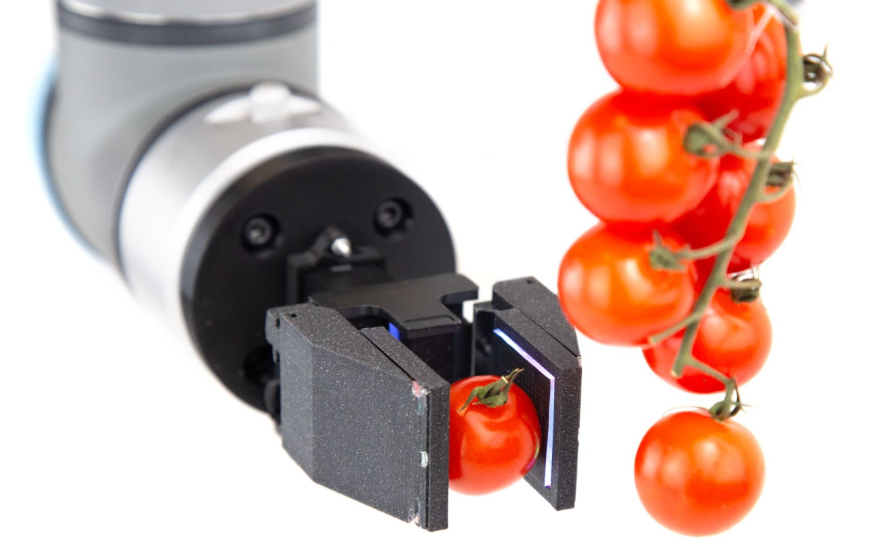
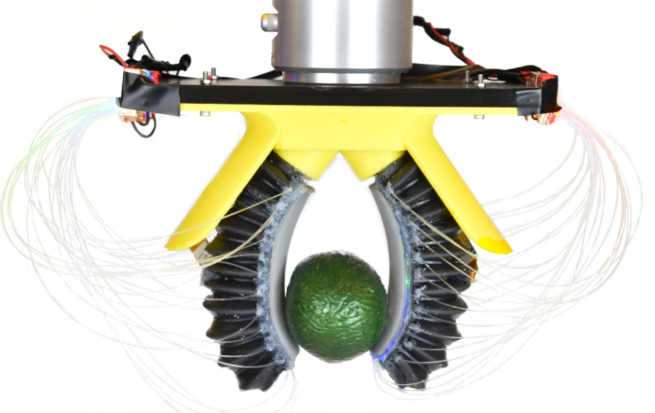
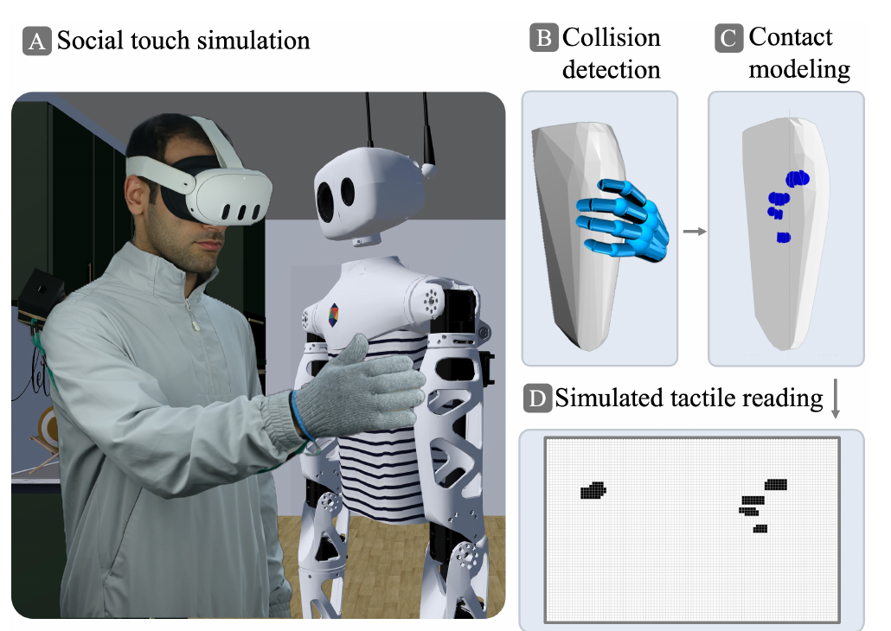

# Ruohan Zhang (张若涵)

I am **Ruohan Zhang (张若涵)**, a **Ph.D. student in Robotics** at the [University of Illinois Urbana–Champaign (UIUC)](https://illinois.edu/), advised by [Prof. Wenzhen Yuan](https://scholar.google.com/citations?user=SNqm6doAAAAJ&hl=en/) in the [RoboTouch Lab](https://robotouchlab.web.illinois.edu/).

My research lies at the intersection of **robot perception, tactile sensing, and manipulation**. I believe tactile perception is a powerful way to understand the physical world—from object properties to contact dynamics—and I am working towards **stable and generalizable manipulation** for robotics. I approach this from two sides: I design tactile sensors and integrate them into robotic end-effectors, and I develop **learning-based active perception**, using reinforcement learning so that robots decide for themselves how to interact with objects to reveal physical properties such as mass and friction[.](/silly-projects/)

I am looking for a <strong>research internship in industry for Summer 2027</strong>. If my work is relevant to your team, please <a href="mailto:rz21@illinois.edu">get in touch</a>.

## Research Interests

- Tactile sensing and perception for understanding the physical world  
- Active perception and reinforcement learning for physical property estimation  
- Stable and generalizable contact-rich manipulation  

## Publications

<h3 class="pub-group">Journal Articles</h3>

  
  

    <h3 class="pub-title"><a href="https://fruittouch-dev.github.io/fruittouch/">FruitTouch: A Perceptive Gripper for Gentle and Scalable Fruit Harvesting</a></h3>
    
Ruohan Zhang, Mohammad Amin Mirzaee, Wenzhen Yuan

    
2026, IEEE, Robotics and Automation Letters (RA-L)

    

      <a href="https://fruittouch-dev.github.io/fruittouch/">Webpage</a>
      <a href="/publication/fruittouch/">Details</a>
    

  

  
  

    <h3 class="pub-title"><a href="https://ruohan-zhang.com/PneuGelSight-project/">PneuGelSight: Soft Robotic Vision-Based Proprioception and Tactile Sensing</a></h3>
    
Ruohan Zhang, Uksang Yoo, Yichen Li, Arpit Agarwal, Wenzhen Yuan

    
2025, Sage, The International Journal of Robotics Research (IJRR)

    

      <a href="https://ruohan-zhang.com/PneuGelSight-project/">Webpage</a>
      <a href="https://arxiv.org/abs/2508.18443">arXiv</a>
      <a href="/publication/pneugelsight/">Details</a>
    

  

<h3 class="pub-group">Conference Papers</h3>

  
  

    <h3 class="pub-title"><a href="https://arxiv.org/abs/2607.11690">Requirement-Driven Design of Whole-Body Social Tactile Sensing via Virtual Human-Robot Interaction</a></h3>
    
Dakarai Crowder, Ruohan Zhang, Alexis E. Block, Wenzhen Yuan

    
2026, IEEE/RSJ International Conference on Intelligent Robots and Systems (IROS)

    

      <a href="https://arxiv.org/abs/2607.11690">arXiv</a>
      <a href="/publication/social-tactile-sensing/">Details</a>
    

  

## Education

- **Ph.D. in Electrical & Computer Engineering** (2023–present)  
  University of Illinois Urbana–Champaign (UIUC)  
- **M.S. in Electrical and Computer Engineering** (2025)  
  University of Illinois Urbana–Champaign (UIUC)  
- **B.Sc. in Electronic Engineering and Information Science** (2019–2023)  
  University of Science and Technology of China (USTC) — Guo Moruo Scholarship (highest honor for undergraduates, ~one per major)

## Contact

- **CV:** [Download CV (PDF)](/files/cv.pdf)
- **Email:** [rz21@illinois.edu](mailto:rz21@illinois.edu)
- **GitHub:** [rhzhang-ustc](https://github.com/rhzhang-ustc)
- **LinkedIn:** [Ruohan Zhang](https://www.linkedin.com/in/ruohan-zhang-uiuc)

  

---

*This site is powered by [Academic Pages](https://academicpages.github.io/) and hosted on [GitHub Pages](https://pages.github.com/).*
